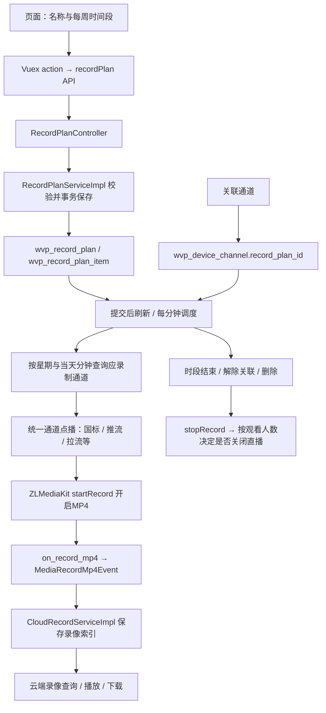

# 录制计划使用与链路检查

## 报错原因

`Column 'name' cannot be null` 表明写入 `wvp_record_plan` 时，Java 对象的 `name` 是 `null`。

当前源码中，页面 `planName` → Vuex `name` → API JSON `name` → `RecordPlan.name` → Mapper `#{name}` 的字段对应正确，没有发现名称字段被改名或遗漏。原来的页面允许不填名称直接保存，后端也只校验时间列表，因此空名称一直传到了数据库。单凭异常不能判断现场是否输入过名称；若输入过仍出现此错误，应检查浏览器 Network 中实际请求体，并确认前后端部署版本一致。

已增加前后端名称校验（去除首尾空格，不能为空，最长255字符）；数据库非空约束保持不变，无需改表或执行升级SQL。

## 怎样使用

这里的计划是在WVP侧按时拉起通道，由流媒体服务器生成云端MP4录像；它不会配置摄像机/NVR本地SD卡或硬盘的录像计划，生成的内容应在“云端录像”中查找。

1. 确认通道能正常实时预览，WVP、Redis、数据库和 ZLMediaKit 均正常，媒体节点对 WVP 的 Hook 地址可达。
2. 打开左侧“录制计划”，点击“添加”，填写名称，例如“工作日白天”。
3. 在星期一至星期日对应的时间轴上，从左向右拖出需要录制的区间。拖动区间端点调整时间；使用“复制”将一天的时间段复制到其他日期。“全选”代表每周七天、每天00:00至24:00；“清空”移除时间段。新拖出的区间至少约10分钟，保存后的时间精度为分钟。
4. 点击“保存”。保存计划只定义时间，必须继续关联通道才会执行。
5. 点击计划的“关联通道”，在“未关联”中勾选通道并点击“添加”；也可“按设备添加”。切换到“已关联”确认关联结果。一个通道只能绑定一个计划；“添加所有通道”会覆盖其他计划的通道绑定，不受当前搜索、分页过滤限制。
6. 计划进入有效时段后自动点播并开启MP4录像，无需一直打开浏览器。计划修改、关联、解除关联和删除后会刷新任务；周期检查每分钟执行一次，时间边界的实际响应可能延迟约一分钟，再加点播耗时。
7. 在“云端录像”中查找录像，按通道/流和时间查看、播放或下载。录像文件在媒体服务器磁盘，WVP数据库保存文件索引。通常要等MP4分片完成，或计划结束停止录像后，才会收到文件完成通知并出现完整录像记录。
8. 停用某个通道的计划：在“已关联”中选中并“移除”；停用整个计划：移除所有通道或删除计划。计划结束时先停止MP4；仍有观众时保留直播，无人观看时再关闭流。

示例：每周一至周五08:00—18:00，在周一画一个区间，再复制到周二至周五并保存、关联通道。跨午夜的时段需要拆成两天，例如周一22:00—24:00与周二00:00—02:00。

使用后端进程所在时区的时间。部署时应确认 JVM/容器时区符合业务需要，例如 `Asia/Shanghai`。

## 完整链路



关键代码：

- `web/src/views/recordPlan/edit.vue`、`web/src/views/common/weekTimePicker.vue`：名称、时间段和保存。
- `web/src/store/modules/recordPlan.js`、`web/src/api/recordPlan.js`：前端数据提交。
- `RecordPlanController`：`/api/record/plan/add`、`update`、`link`、`get`、`query`、`delete`。
- `RecordPlanServiceImpl`：校验、事务、调度、流断开恢复和录像状态。
- `RecordPlanMapper`、`CommonGBChannelMapper`：计划主表/时间项、通道关联和当前任务查询。
- `GbChannelPlayServiceImpl`：按通道类型调用点播服务；已有直播会被复用。
- `ZLMMediaNodeServerService`、`ZLMRESTfulUtils`：动态启停MP4，不必重启已有直播。
- `ZLMHttpHookListener`、`CloudRecordServiceImpl`：录像完成通知与索引入库。

时间项约定：`weekDay` 为1—7（周一—周日）；`start`、`stop` 是当天分钟数，区间为 `[start, stop)`，满足 `0 ≤ start < stop ≤ 1440`。例如08:00—18:00是480—1080。部分历史注释仍写半小时索引或星期0—6，应以当前实现为准；旧版本数据按对应版本升级脚本迁移，不应重复转换。

API请求示例（省略认证头）：

```json
{
  "name": "工作日白天",
  "planItemList": [
    { "weekDay": 1, "start": 480, "stop": 1080 },
    { "weekDay": 2, "start": 480, "stop": 1080 }
  ]
}
```

POST `/api/record/plan/add` 创建后，通过 GET `/api/record/plan/query?page=1&count=15` 获取计划ID，再 POST `/api/record/plan/link`：

```json
{ "planId": 10, "channelIds": [123, 124] }
```

`channelIds` 使用通用通道的数据库ID，即通道列表返回的 `gbId`，不是20位国标通道编码。解除指定通道关联时省略 `planId`。编辑使用 `/update`，请求包含计划 `id`、`name` 和完整 `planItemList`，会替换原时间段。创建接口仍保持原有返回约定，不直接返回新ID。

## 本次检查和修复

| 环节 | 原问题 | 修复 |
| --- | --- | --- |
| 新建/编辑 | 空名称直接进入SQL；非法时间项可能被跳过或导致异常 | 写库前统一校验名称、星期、时间和非空列表 |
| 保存反馈 | 保存失败也关闭窗口，用户填写内容丢失 | 失败保留窗口和内容；提交时防重复点击 |
| 时间选择 | 合并、复制后替换的数组可能没有回传到父组件 | 双向同步，并在合并、复制时发出更新事件 |
| 时间组件 | 未选中时删除会异常；销毁后遗留全局鼠标监听 | 空选择保护；销毁时移除监听 |
| 通道关联 | 翻页后重新初始化回到第一页；搜索重置每页数量 | 正确保留分页参数 |
| Mapper | 多参数列表隐式依赖编译器保留参数名 | 显式标注列表参数；查询与批量添加只处理真实通道 |
| 时间匹配 | stop使用大于等于，结束后多匹配一分钟 | 使用左闭右开区间 |
| 更新/批量关联 | 更新、删除有刷新TODO；全部关联/清理未刷新 | 数据提交后刷新；普通/全部关联和清理也刷新 |
| 关联合法性 | 可以关联不存在的计划；同时传设备ID和通道ID时忽略设备ID | 校验计划存在；合并两类指定通道 |
| 已有直播 | 点播复用已有流时，record=true并不会补开MP4 | 点播成功后显式调用媒体节点startRecord |
| 计划结束 | 有观众时不关流，也没有停止MP4，导致继续录像 | 先stopRecord，再决定是否关闭直播 |
| 状态并发 | 普通HashMap被定时任务、接口和异步回调并发操作 | 并发容器；串行协调任务；防止点播在途时重复启动 |
| 异步竞态 | 点播回调晚到，可能在计划失效后继续录制；断流无条件重拉 | 回调再次核对计划；失效则停止；断流重新查询计划 |
| 故障重试 | 单个通道抛异常可能中断其他通道；停止失败即丢失状态 | 通道异常隔离；停止失败保留状态，下次调度重试 |

动态录像参数已对照 [ZLMediaKit官方HTTP API](https://docs.zlmediakit.com/zh/guide/media_server/restful_api.html) 核对，使用 `type=1` 录制MP4，并同时检查返回的 `code` 和 `result`。

## 配置与验收边界

- 本次动态录像适配的是 **ZLMediaKit**。ABL节点当前没有动态startRecord/stopRecord实现，不应据此认定其定时录像可用；未适配节点会返回失败并记录日志。
- `user-settings.record-sip`、`user-settings.record-push-live` 控制常规点播/推流时的默认录像，并不是录制计划总开关。如果希望只在计划时段录制，应将这些全局录像配置按需关闭，同时关闭拉流代理等来源上的独立录像开关。计划结束会停止对应流的MP4；当前系统没有多种录像任务之间的引用计数或所有权协调。
- `media.record-path` 是媒体节点使用的录像目录，要保证媒体服务用户可写、磁盘有空间；容器应将该目录持久化。`protocol.mp4_max_second` 影响分片时长。`on_record_mp4` 地址必须能回调WVP，否则磁盘有文件但“云端录像”中可能没有索引。
- `record-assist-port` 用于部分录像合并下载能力；基本录像写盘和完成事件入库不依赖先创建合并下载任务。
- `snap` 字段目前没有在这条链路中实现定时截图调度；不能将录制计划当作截图计划使用。
- 执行状态保存在本机内存，尚无集群级的录制任务锁/归属协调。多个WVP实例共用数据库时可能同时调度同一计划，不能将单机测试视为集群验收。进程重启后会重新扫描有效计划；停机跨过计划结束时间时，已有媒体流的录像状态仍需部署环境确认。
- 本次为源码检查、单元测试和构建验证，未连接现场设备、数据库或媒体节点进行真实录像验收。

建议现场验收顺序：创建空名称确认被拦截 → 正常新建并重新打开核对时间 → 将已有直播的通道关联到当前有效计划 → 确认MP4产生 → 保持一位观众并解除关联，确认录像停止、直播继续 → 等分片完成后在云端录像播放 → 断流后确认有效计划重试 → 结束后确认不再重拉。
